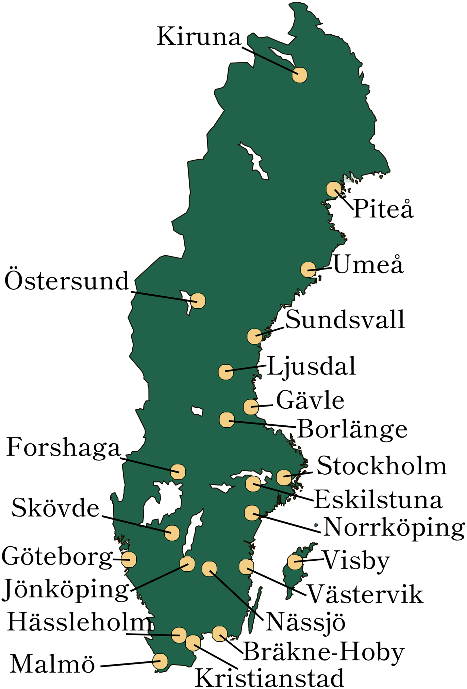
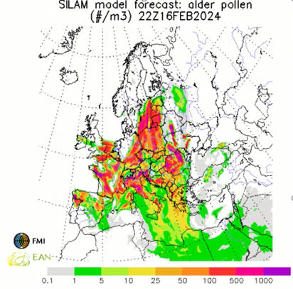

```{r setup, include=FALSE}
knitr::opts_chunk$set(echo = FALSE, fig.cap = TRUE, message = FALSE, warning = FALSE, dpi = 600)
library(officedown)
library(officer)
library(tidyverse)
library(pollenYearbook)
daily_conc <- readRDS("daily_conc.rds")
library(flextable)
report_year <- 2026

autonum_tab <- run_autonum(seq_id = "tab", pre_label = "Tabell ")
autonum_fig <- run_autonum(seq_id = "fig", pre_label = "Figur ")

report_stations <- structure(1:24, levels = c("Malmö", "Kristianstad", "Hässleholm", 
"Bräkne-Hoby", "Visby", "Nässjö", "Göteborg", "Göteborg Östra sjukhuset", "Västervik", 
"Jönköping", "Skövde", "Norrköping", "Stockholm", "Eskilstuna", 
"Forshaga", "Borlänge", "Gävle", "Ljusdal", "Sundsvall", "Östersund", 
"Umeå", "Storuman", "Piteå", "Kiruna"), class = "factor")
south_stations <- c("Malmö", "Hässleholm", "Jönköping", "Göteborg Östra sjukhuset", "Västervik", "Norrköping")
north_stations <- c("Eskilstuna", "Stockholm", "Umeå", "Borlänge", "Forshaga", "Sundsvall")

data <- daily_conc |> filter(station %in% report_stations, year <= report_year)

# Word landscape figures: use physical dimensions rather than knitr out.width.
landscape_figure <- function(plot, width = 10, height = 5.5) {
  file <- tempfile(fileext = ".png")

  ggplot2::ggsave(
    filename = file,
    plot = plot,
    width = width,
    height = height,
    dpi = 300
  )

  officer::fpar(
    officer::external_img(src = file, width = width, height = height),
    fp_p = officer::fp_par(text.align = "center")
  )
}
```

```{r}
block_toc()
```


# Inledning

I denna sammanställning presenteras pollensäsongen för ett flertal växtslag. Al, björk, gräs och gråbo är några av de mest betydande allergiframkallande pollenslag som förekommer i luften från tidig vår till sensommar. De redovisas här i form av text, tabeller och grafer. Övriga allergena pollenslag, så som sälg och viden, alm, bok och ek redovisas mer översiktligt i tabeller som återfinns i appendix. Säsongsdata i tabellerna redovisas för samtliga mätstationer som varit i drift under säsongen  `r report_year`. 

Syftet med att mäta pollen är att ge allergiker information om pollenhalterna i luften och att göra pollenprognoser, det vill säga förutsäga när pollen av ett visst slag börja förekomma och när halterna ökar.

Pollensäsongen börjar vanligtvis i februari - mars med spridning av pollen från al och hassel, men hasselpollen kan vissa år förekomma redan i november - december. Pollensäsongen fortsätter sedan med vårblommande träd som alm, viden, björk, ek och bok; dessa vinter- och vårblommande träd är vindpollinerade och har allergena pollen i varierande grad. I maj-juni blommar tall och gran; deras pollen räknas normalt inte som allergiframkallande men förekommer ofta i mycket stor mängd. Gräsen börjar blomma i maj och fortsätter under sommaren och mot slutet av säsongen kommer de örtartade växterna gråbo och malörtsambrosia, vars pollen också är allergena.

I denna sammanställning ingår även sporsäsongen, det vill säga registrerad förekomst av några mögelsporer *Cladosporium* och *Alternaria*. Den huvudsakliga förekomsten av dessa är under sommaren och hösten.


Uppgifter om väder, temperatur och vindar är hämtade från Månadens väder och vatten på SMHIs webbplats [www.smhi.se](https://www.smhi.se). 
Vissa uppgifter om växternas blomning är hämtade från Svenska fenologinätverket [www.naturenskalender.se](https://www.naturenskalender.se) där observatörer kan rapportera sina iakttagelser kring växters blomning, lövsprickning m.m. 


# Metodik

## Polleninsamling och pollenanalys

För insamling av luftburna pollen används i Sverige en volumetrisk pollenfälla av typen Burkard Seven-Day Recording Volumetric Spore Trap. En eldriven fläkt suger in en konstant luftström genom en smal spalt (2 x 14 mm) med en volym på cirka 10 liter per minut, ungefär motsvarande den mängd luft som en människa i vila andas in. 

Bakom spalten sitter en roterande trumma, 20 mm bred, med en utbytbar, klibbig tejp. Luftströmmen träffar den del av tejpen som sitter omedelbart bakom spalten. Trumman drivs av ett urverk som roterar 2 mm per timme vilket innebär att under en timme exponeras 2 mm av tejpen. På ett dygn roterar trumman 48 mm och i loppet av 7 dygn ett helt varv.

Luftens innehåll av partiklar som pollen, sporer, sot, damm fastnar successivt på tejpen. När det är dags för analys klipps den exponerade tejpen i 48 mm långa bitar som representerar ett dygn och monteras på ett objektglas varefter provet studeras i ljusmikroskop i 400 gångers förstoring. Under analysen identifieras och räknas antalet pollen och sporer. 

För varje dygn analyseras 12 tvärband, ett för varannan timme. De uppmätta antalen pollen adderas och omräknas till pollen per kubikmeter luft och redovisas som ett dygnsmedelvärde. Till exempel betyder värdet 205 för ett visst pollenslag att under det angivna dygnet registrerades 205 pollen per kubikmeter luft. 

Den använda metoden motsvarar den praxis som utvecklats i samråd mellan mätstationerna i Sverige.


## Registrering av luftburna pollen

De pollenslag som fångas i pollenfällor kommer till största delen från vindpollinerade växter. Dessa växter producerar mycket större pollenmängder än insektspollinerande arter och endast en försvinnande liten del når de honliga blomdelarna vid pollinering. Man räknar med att merparten av det pollen som registreras i en pollenfälla kommer från den lokala vegetationen inom en radie på ungefär tio kilometer. På regional skala kan pollen spridas omkring hundra kilometer och under speciella väderförhållanden kan pollen transporteras med vinden över kontinenter, flera tusen kilometer. Inslaget av sådan så kallad fjärrtransport kan vara en betydande del av mängden pollen som registreras.

Antalet växtslag vars pollen vanligen registreras och analyseras är drygt trettio. Om andra pollen förekommer bestäms de om möjligt till art, släkte eller familj, annars registreras de som ”obestämda” eller ”övriga pollen”. Vanligtvis rör det sig om bara något enstaka sådant pollen per dygn. Beroende på klimatet, skiljer sig antalet registrerade pollenslag mellan södra och norra Sverige. Långt ifrån alla i Sydsverige analyserade växtslag förekommer i Norrland.


## Definition av pollensäsong

Den kontinuerliga registreringen av pollen under säsongen och de sammanställda analysresultaten visar när pollenspridningen börjar, hur omfattande den är och hur länge den pågår. I denna sammanställning definieras startdatum för pollensäsongen som det dygn då den ackumulerade mängden av ett visst pollenslag når 2,5 procent av årssumman och slutdatum som det dygn då ackumuleringen når 97,5 % av årssumman. 

Viktigt att komma ihåg är att pollensäsong inte är detsamma som blomningsperiod. Tidsmässigt sammanfaller pollensäsongen huvudsakligen med växternas blomningsperioder, men förekomst av pollen i luften påverkas också av att vindpollinerade arters pollen kan transporteras långa sträckor. Därför kan pollen förekomma i luften både före och efter den lokala blomningsperioden. Mindre mängder pollen kan även påträffas utanför blomningssäsongen på grund av en viss recirkulation av sedimenterat pollen som avsatts på ytor och som senare fångas upp av vinden.


## Analysarbete och framtagning av pollenprognoser 

Resultaten från pollenanalyserna tillsammans med väderprognoser för de närmaste dagarna är centrala parametrar i underlaget för pollenprognoserna för de orter där mätningarna genomförs. Arbetet med pollenanalys och framtagning av prognoser för rapportering till allmänheten har under `r report_year` utförts vid följande pollenlaboratorier:

- Pollenlaboratoriet vid Göteborgs universitet har ansvarat för två mätstationer i Göteborg samt utfört analyser av prover från mätstationerna i Malmö, Kristianstad, Hässleholm, Bräkne-Hoby, Skövde och Östersund. 
Primäranalyserna har gjorts av Åslög Dahl, Robert Daun, Nestor Gonzáles Roldán, Linnéa Hén, Ylva Larsson och Klara Persgården.

- Palynologiska laboratoriet vid Naturhistoriska riksmuseet har ansvarat för mätstationen i Stockholm samt utfört analyser av prover från mätstationerna i Visby, Jönköping, Forshaga, Borlänge, Gävle, Ljusdal och Kiruna.
Primäranalyserna har gjorts av Agneta Ekebom, Björn Gedda, Miranda Mrozek, Ylva Palmgren, Yessenia Rojas Sepulveda, Peter Wingård och Pia Östensson. 

- Miljöarkeologiska laboratoriet vid Umeå universitet har ansvarat för mätstationen i Umeå samt utfört analyser av prover från Sundsvall, Piteå, Storuman och Nässjö. 
Primäranalyserna har gjorts av Christos Katrantsiotis och Kristian Hristov.


Vid ytterligare tre mätstationer har analys-och prognosarbetet skett på plats:

- Klinisk kemi och transfusionsmedicin vid Västerviks sjukhus har ansvarat för mätstationen i Västervik. 
Primäranalyserna har gjorts av Ann-Cathrin Petersén, Aleksandra Duda, Cecilia Ohlsén, Zainab Al-Asafi, Raja Ericsson, Caroline Thoresson, Sofia Öjkvist och Sofie Johansson.

- Laboratoriemedicin vid Vrinnevisjukhuset har ansvarat för mätstationen i Norrköping. Primäranalyserna har gjorts av Maria Ahl, Mia Cervo Cesko, Evan Hendo, Emma Lindkvister, Amenah Mohammed, Nancy Mokhtar, Sofia Starck och Mikaela Wering Eklöf.

- Laboratoriemedicin vid Vrinnevisjukhuset har ansvarat för mätstationen i Norrköping. Primäranalyserna har gjorts av Maria Ahl, Mia Cervo Cesko, Evan Hendo, Emma Lindkvister, Amenah Mohammed, Nancy Mokhtar, Sofia Starck och Mikaela Wering Eklöf.


## Rapportering av pollenprognoser till allmänheten

Naturhistoriska riksmuseets webbplats för pollenprognoser, [www.pollenrapporten.se](https://www.pollenrapporten.se) visar prognoser för de orter där mätningar utförs. Prognoserna återfinns också i mobilappar, tidningar, radio, text-tv och på flera andra webbplatser. Sedan 2024 görs pollenprognoserna fritt tillgängliga genom ett öppet API.
Tidpunkten för när mätningarna startar för säsongen varierar mellan mätstationerna, främst beroende på geografiskt läge (Tabell 2). Med allt mildare vintrar ökar behovet av tidigare mätningar och att prognoserna publiceras tidigt på säsongen. 

Under `r report_year` inleddes rapporteringen av prognoser, med minst två publiceringar per vecka baserade på aktuella analysresultat, i mitten av februari i södra Sverige och under mars i landets nordliga delar.


## Mängdklasser för pollenprognoser och uppmätta halter 

De pollen som registreras vid mätningarna, identifieras och räknas till antal samt omräknas till att motsvara en viss mängd pollen per kubikmeter luft och dygn. För vetenskapliga och kliniska ändamål rapporteras dessa numeriska värden, men för allmänhetens bruk omvandlas de till fyra mängdklasser: låga, måttliga, höga eller mycket höga halter. 
I tabellen nedan anges gränsvärdena för varje mängdklasser och växtslag. Samma mängdklass kan ha olika gränsvärden för träd respektive örtartade växter, detta på grund av deras olika förmåga att sprida sitt pollen. Pollen som släpps från träd fångas lättare upp av vinden och transporteras längre än pollen från gräs och örter som släpps närmare marken. Den högsta klassen, mycket höga halter, används främst för björkpollen och mer sällan för andra pollenslag. 

Gränsvärdena är nationella och har fastställts i samarbete med allergologer, baserat på klinisk erfarenhet. Gränsvärdena kan dock skilja sig åt mellan olika länder.
2014 beslutade företrädare för Sveriges pollenlaboratorier att sänka det övre gränsvärdet för höga halter gräspollen från 100 till 80. 

```{r}
block_caption(
  label = "Mängdklassernas gränsvärden, uttryckta i antalet pollen (sporer) per kubikmeter luft och dygn.",
  style = "Table",
  autonum = run_autonum(seq_id = "tab", pre_label = "Tabell ", bkm = "levels_tab")
)

levels_tab
```

# Pollenmätstationer

## Nationell pollenövervakning

Naturhistoriska riksmuseet ansvarar för pollenövervakningen i Sverige. Sedan 2022 är detta uppdrag en del av myndighetens instruktion och Naturhistoriska riksmuseet ansvarar därmed för att finansiera, samordna och utveckla pollenverksamheten i landet. 
Stommen i det nationella pollennätverket består av tre centrum dit prover från landets pollenmätstationer i huvudsak skickas för analys. Dessa centrum utgörs av pollenlaboratorier vid Göteborgs universitet, Umeå universitet och av Palynologiska laboratoriet vid Naturhistoriska riksmuseet. Det finns dessutom tre mindre nätverksnoder som utför analyser på plats. (Se även avsnittet 2.4. Analysarbete och framtagning av pollenprognoser).
Uppdragen och medlen för att utföra mätningar, analyser samt framställa pollenprognoser fördelas av museet.  

## Mätstationer

I början på 1970-talet startade de första mätningarna av luftburet pollen i Stockholm och under åren som följt har mätningar etablerats på fler orter. Idag är det fem orter som har obrutna mätserier på mer än 40 år; Stockholm, Göteborg, Eskilstuna, Malmö och Umeå. 
Under säsongen `r report_year` har mätningar utförts på 22 orter, men vid totalt 23 mätstationer då mätningar har utförts på två platser i Göteborg. 

```{r, , fig.width = 3, fig.height=4.5}
block_caption(
  label = glue::glue("Stationsnätet {report_year}."),
  style = "Figure",
  autonum = run_autonum(seq_id = "fig", pre_label = "Figur ", bkm = "map_fig")
)

```

## Mätperiod för stationerna

Tidpunkten för när mätningarna startar för säsongen varierar mellan mätstationerna, främst beroende på geografiskt läge. Tidpunkten för starten varierar också mellan år beroende på vädret, hur ihållande vinterkylan är eller om vädret under januari och februari växlar mellan kalla och milda perioder. I Stockholm, Göteborg och Malmö pågår mätningarna i stort sett året runt. Även i Umeå pågår mätningar under större delen av året.

```{r}
block_caption(label = "Översikt över mätstart och mätslut samt eventuella driftstörningar.",
              style = "Table", 
              autonum = run_autonum(seq_id = "tab", pre_label = "Tabell ", bkm = "errors_tab"))
table_errors(data, report_year) 
```

## Kort presentation av stationerna

### Malmö
Pollenfällan är placerad på Universitetssjukhuset MAS. 
Fällans höjd över marken är ca 15 m.
Vegetationen inom en radie av 200 m från fällan består av parkvegetation. 
Verksamheten drivs i regi av Pollenlaboratoriet vid Göteborgs universitet, som har skött analyserna och utarbetat pollenprognoserna. 
Tömningen av pollenfällan har skötts av personal som arbetar med den tekniska driften av sjukhuset.

### Kristianstad
Pollenfällan är placerad på Centralsjukhuset i Kristianstad. 
Fällans höjd över marken är ca 14 m. Vegetationen inom en radie av 200 meter från fällan består av gles parkvegetation. 
Verksamheten drivs i regi av Pollenlaboratoriet vid Göteborgs Universitet, som har skött analyserna och utarbetat pollenprognoserna.
Tömningen av pollenfällan har skötts av personal som arbetar med den tekniska driften av sjukhuset. 

### Hässleholm
Pollenfällan är placerad på Hässleholms sjukhus. 
Fällans höjd över marken är ca 12 m. 
Vegetationen inom en radie av 200 meter från fällan består av gles parkvegetation samt ett par blandskogspartier. 
Verksamheten drivs i regi av Pollenlaboratoriet vid Göteborgs Universitet, som har skött analyserna och utarbetat pollenprognoserna.
Tömningen av pollenfällan har skötts av personal som arbetar med den tekniska driften av sjukhuset. 

### Bräkne-Hoby
Pollenfällan är placerad på Blekinge läns folkhögskola i Bräkne-Hoby. 
Fällans höjd över marken är 4-5 m. 
Vegetationen inom en radie av 200 m från fällan består av blandlövskog, öppen gräsmark.
Verksamheten drivs i regi av Pollenlaboratoriet vid Göteborgs universitet, som har skött analyserna och utarbetat pollenprognoserna. 
Tömningen av pollenfällan har skötts av vaktmästarna vid folkhögskolan.

### Visby
Pollenfällan är placerad på rådhusets tak på Visborg. 
Fällans höjd över marken är 16 m. 
Vegetationen inom en radie av 200 m från fällan består av parkvegetation med blandade lövträd, exempelvis lind och björk samt tallskogspartier.
Verksamheten drivs i regi av Palynologiska laboratoriet vid Naturhistoriska riksmuseet, som har skött analyserna och utarbetat pollenprognoserna. 
Tömningen av pollenfällan har skötts av personal vid Samhällsbyggnadsförvaltningen, Enheten för miljö- och hälsoskydd, Region Gotland.

### Nässjö 
Pollenfällan är placerad på kommunhuset Vipan, Nässjö. 
Fällans höjd över marken är 16 meter. 
Vegetationen inom en radie av 200 m från fällan består av tätortsbebyggelse med gräsytor och planterade lövträd bl.a. lind, alm, björk och pil. 
Verksamheten drivs i regi av Miljöarkeologiska laboratoriet vid Umeå universitet, som har skött analyserna och utarbetat pollenprognoserna. 
Tömningen av pollenfällan har skötts av personal vid Samhällsbyggnadskontoret, Nässjö.

### Göteborg Östra sjukhuset
Den ordinarie pollenfällan är placerad på Sahlgrenska Universitetssjukhuset – Östra Sjukhusets centralklinik.
Fällans höjd över marken är drygt 30 m. 
Vegetationen inom en radie av 200 m från fällan består av lövskog dominerad av björk, gräsmattor, prydnadsbuskar. 
Verksamheten drivs i regi av Pollenlaboratoriet vid Göteborgs universitet, som har skött analyserna, utarbetat pollenprognoserna och tömt pollenfällan.

### Göteborg
En extra pollenfälla för utvärdering har under säsongen varit placerad på Natrium, Medicinareberget, Göteborgs universitet.
Fällans höjd över marken är drygt 30 m. 
Vegetationen inom en radie av 200 m från fällan består av lövskog dominerad av björk, gräsmattor, prydnadsbuskar. 
Verksamheten drivs i regi av Pollenlaboratoriet vid Göteborgs universitet, som har skött analyserna, tömt pollenfällan.

### Västervik
Pollenfällan är placerad på den gamla helikopterplattan på Västerviks sjukhus. 
Fällans höjd över marken är 25-30 m. 
Vegetationen inom en radie av 200 m från fällan består av planteringar, mindre gräsytor, alléträd.
Mätstationen i Västervik drivs inom ramen för verksamheten vid Diagnostiskt centrum, Region Kalmar län. Klinisk kemi och transfusionsmedicin vid Västerviks sjukhus, har skött analyserna, utarbetat pollenprognoserna och tömt pollenfällan. 

### Jönköping 
Pollenfällan är placerad på Länssjukhuset, Ryhov. 
Fällans höjd över marken är cirka 6 m.
Vegetationen inom en radie av 200 m från fällan består av gräsmattor, planteringar med lönn, gran och tall. 
Verksamheten drivs i regi av Palynologiska laboratoriet vid Naturhistoriska riksmuseet, som har skött analyserna och utarbetat pollenprognoserna. Tömningen av pollenfällan har skötts av personal vid sjukhusets patiensservice. 

### Skövde 
Pollenfällan är placerad på Skaraborgs sjukhus, Skövde. 
Fällans höjd över marken är ca 35 m.
Vegetationen inom en radie av 200 m från fällan består främst av gles parkvegetation samt klippta gräsytor.
Verksamheten drivs i regi av Pollenlaboratoriet vid Göteborgs universitet, som har skött analyserna och utarbetat pollenprognoserna. 
Tömningen av pollenfällan har skötts av personal som arbetar med den tekniska driften av sjukhuset.

### Norrköping
Pollenfällan är placerad på helikopterplattan på Vrinnevisjukhuset.
Fällans höjd över marken är 18,5 m.
Vegetationen inom en radie av 200 m från fällan består av närliggande barrskog, åker/ängsmark, planterade träd bl.a. asp, björk och lärk.
Mätstationen i Norrköping drivs inom ramen för verksamheten vid Laboratoriemedicin sjukhus, Region Östergötland, vid Vrinnevisjukhuset som har skött analyserna, utarbetat pollenprognoserna och tömt pollenfällan. 

### Stockholm
Pollenfällan är placerad på Meteorologiska inst., Stockholms universitet, Frescati.
Fällans höjd över marken är ca 15 m.
Vegetationen inom en radie av 200 m från fällan består av parkområde med främst ek och björk, stora gräsmarker samt odlade buskar.
Mätstationen i Stockholm drivs inom ramen för verksamheten vid Palynologiska laboratoriet, Naturhistoriska riksmuseet. Palynologiska laboratoriet har skött analyserna, utarbetat pollenprognoserna och tömt pollenfällan.

### Eskilstuna
Pollenfällan är placerad på Mälarsjukhuset.
Fällans höjd över marken är 15 m.
Vegetationen inom en radie av 200 m från fällan består av tall- och granskog, björk, gräs-områden, enstaka popplar, lindar, lönnar och ekar.
Mätstationen i Eskilstuna drivs inom ramen för verksamheten vid Klinisk mikrobiologi, Unilabs AB, Laboratoriemedicin Region Sörmland vid Mälarsjukhuset som har skött analyserna, utarbetat pollenprognoserna och tömt pollenfällan.

### Forshaga
Pollenfällan är placerad på kommunhusets tak, Miljö- och byggförvaltningen i Forshaga. 
Fällans höjd över marken är 7 m.
Vegetationen inom en radie av 200 m från fällan består av tätortsbebyggelse med gräsytor och enstaka björk och tall. På längre avstånd finns tall, gran och björk samt invid Klarälven bestånd av al och viden.
Verksamheten drivs i regi av Palynologiska laboratoriet vid Naturhistoriska riksmuseet, som har skött analyserna och utarbetat pollenprognoserna. Tömningen av pollenfällan har skötts av personal vid Miljö- och byggförvaltningen, Forshaga kommun.

### Borlänge
Under pågående säsong har pollenfällan flyttats från Högskolan Dalarnas tidigare lokaler på Röda vägen i Borlänge, till nya Campus Borlänge mitt i centrum. 
För den nya placeringen är fällans höjd över marken ca 22 m.
Vegetationen inom en radie av 200 m från fällans nya placering består av tätortsbebyggelse med planterade träd, bl.a. lind, lönn, björk och ek samt parkvegetation med mindre gräsytor.
Verksamheten drivs i regi av Palynologiska laboratoriet vid Naturhistoriska riksmuseet, som har skött analyserna och utarbetat pollenprognoserna. Tömningen av pollenfällan har skötts av vaktmästarna på Fastighetsavdelningen, Högskolan Dalarna.

### Gävle
Pollenfällan är placerad på Länsstyrelsens Gävleborg tak.
Fällans höjd över marken är ca 15 m.
Vegetationen inom en radie av 200 m från fällan består av tätortsbebyggelse med parkliknande vegetation bestående av främst lind, björk, alm och lönn samt enstaka al invid närliggande Gavleån.  
Verksamheten drivs i regi av Palynologiska laboratoriet vid Naturhistoriska riksmuseet, som har skött analyserna och utarbetat pollenprognoserna. Tömningen av pollenfällan har skötts av personal på Miljöenheten, Länsstyrelsen Gävleborg.

### Ljusdal 
Pollenfällan är placerad på tornet vid Räddningstjänsten, Ljusdal.
Fällans höjd över marken är ca 10 m.
Vegetationen inom en radie av 200 m från fällan består av gräsytor, industriområde och parkvegetation.
Verksamheten drivs i regi av Palynologiska laboratoriet vid Naturhistoriska riksmuseet, som har skött analyserna och utarbetat pollenprognoserna. Tömningen av pollenfällan har skötts av Brandmännens idrottsförening, Ljusdal.

### Sundsvall
Pollenfällan är placerad på Sundsvalls sjukhus.
Fällans höjd över marken är 39 meter.
Vegetationen inom en radie av 200 m från fällan består av gräsytor, parkeringsytor och parkvegetation. Närliggande skogsområden med gran, tall och björk samt gynnsam sydsluttning med ädellövträd.
Verksamheten drivs i regi av Miljöarkeologiska laboratoriet vid Umeå universitet som har skött analyserna och utarbetat pollenprognoserna.  Tömningen av pollenfällan har skötts av Transportenheten, Sundsvalls sjukhus.

### Östersund
Pollenfällan är placerad på Östersunds sjukhus.
Fällans höjd över marken är ca 10 meter.
Vegetationen inom en radie av 200 m från fällan består av stadsmiljö i söder och öster samt av parkmiljö med lövträd och gräsytor i norr och väster. 150 m västerut finns även Storsjön.
Verksamheten drivs i regi av Pollenlaboratoriet vid Göteborgs universitet som har skött analyserna och utarbetat pollenprognoserna. Tömningen av pollenfällan har skötts av personal som arbetar med den inre servicen vid sjukhuset.

### Umeå
Pollenfällan är placerad på Samhällsvetarhusets tak, Umeå universitet.
Fällans höjd över marken är ca 15 meter.
Vegetationen inom en radie av 200 m från fällan består av parkmiljö med lövträd och gräsmattor samt tallskog 
Verksamheten drivs i regi av Miljöarkeologiska laboratoriet vid Umeå universitet som har skött analyserna, utarbetat pollenprognoserna och tömt pollenfällan.

### Storuman

### Piteå
Pollenfällan är placerad på taket av Samhällsbyggnads lokaler – Stadsporten.
Fällans höjd över marken är ca 7 meter.
Vegetationen inom en omkrets av 200 m från fällan består av stadsmiljö med mindre gräsytor och trädgrupper.  
Verksamheten drivs i regi av Miljöarkeologiska laboratoriet vid Umeå universitet som har skött analyserna och utarbetat pollenprognoserna. Tömningen av pollenfällan har skötts av personal vid Miljö- och hälsoskydd, Samhällsbyggnad, Piteå kommun.

### Kiruna
Pollenfällan är placerad på Stadshuset, Kristallens tak.
Fällans höjd över marken är ca 25 m.
Vegetationen inom en omkrets av 200 m från fällan består av stadsmiljö, parkeringsytor samt ytor med glesa bestånd av främst tall och björk.  
Verksamheten drivs i regi av Palynologiska laboratoriet vid Naturhistoriska riksmuseet, som har skött analyserna och utarbetat pollenprognoserna. Tömningen av pollenfällan har skötts av personal vid Kiruna kommun.


# Pollensäsongen

## Al (*Alnus*)


I Sverige finns två inhemska arter av al: klibbal och gråal. Klibbal förekommer huvudsakligen söder om Norrlandsgränsen medan gråal huvudsakligen finns i Norrland och delar av Svealand. Gråal är inte särskilt vanlig i Sydsverige, men den förekommer vid vissa vattendrag och odlas ibland som prydnadsträd. Under milda vintrar kan gråalens blomning i södra Sverige starta så tidigt som i januari eller februari, vilket är långt tidigare än klibbalen som normalt startar sin blomning i mars. 
Alträdens hängen är exempel på blomställningar som bildas på sensommaren året före blomning. Under hösten och vintern fortgår hängenas utveckling för att sedan mogna och släppa pollen tidigt på vårvintern. För att veta när den lokala blomningen och pollensläppet startar behöver man kontinuerligt följa hängenas utveckling. 
Svenska fenologinätverket samlar in observationer av vårtecken så som växternas lövsprickning och blomning och bedriver på det sättet en långsiktig miljöövervakning. Observationerna genomförs av frivilliga och professionella så kallade fenologiväktare. Palynologiska laboratoriet vid Naturhistoriska riksmuseet i Stockholm samt Pollenlaboratoriet vid Göteborgs universitet bidrar med sina observationer av framförallt blomningen hos växter vars pollen är allergiframkallande. Observationerna rapporteras till [www.naturenskalender.se](https://www.naturenskalender.se). 

En annan orsak till att alpollen brukar kunna förekomma i luften tidigt på året, bortsett från inhemsk blomning hos gråal och planterade arter som exempelvis berlineral, är fjärrtransport från blomning i Centraleuropa. 

I januari 2024 fortsatte kylan från december, med ovanligt kalla dagar i början av månaden men sedan betydligt mildare väder mot slutet. I Stockholm dröjde därför starten av pollenmätningarna till den 24 januari, och först nästan en månad senare, den 22 februari, började alpollen förekomma i luften i Stockholm. Vid den tidpunkten rörde det sig främst om fjärrtransporterade alpollen som förts in med vindar från blomning utanför landets gränser. De fenologiska observationerna i Stockholm noterade nämligen blommande bestånd av gråal först den 4 mars, medan klibbalens blomning startade den 15 mars. Mars var allmänt något varmare än normalt.

Fjärrtransporterade luftpaket som innehåller pollen kan nå in över landet på olika sätt, vilket illustreras av en bild från prognosmodellen SILAM, figur `r run_reference("silam_fig")`. 
Figuren visar modellens prognos för pollenkoncentration den 16 februari där koncentrationen utanför Sveriges sydöstra kust är förhållandevis hög. Prognosen kan jämföras med de pollenhalter som registrerades vid mätstationerna. I bland annat Visby noterades en tydlig topp samma datum medan motsvarande topp inte kunde påvisas exempelvis i Stockholm eller Norrköping (se figur `r run_reference("season_1a_fig")` och `r run_reference("season_1b_fig")`). Figur `r run_reference("season_1a_fig")` antyder också att detta luftpaket med alpollen sannolikt hade kunnat detekteras i Västervik, om mätningarna där hade varit igång.


```{r, fig.width = 4, fig.height=4}
block_caption(
  label = glue::glue("Bild från prognosmodellen SILAM den 16 februari 2024 kl. 22."),
  style = "Figure",
  autonum = run_autonum(seq_id = "fig", pre_label = "Figur ", bkm = "silam_fig")
)

```


```{r}
block_caption(label = glue::glue("Al. Sammanställning av säsongen {report_year} för samtliga stationer i Sverige. Se avsnitt 3.3 för driftstörningar som kan förklara avvikande värden."), 
              style = "Figure", 
              autonum = run_autonum(seq_id = "tab", pre_label = "Tabell ", bkm = "alnus_season_tab"))
table_seasons(data, "Alnus", report_year)
```

### Årssummor

I figurerna markeras stationens första mätår med lodrät linje om det faller inom den redovisade perioden. År med många tekniska fel är markerade med grå staplar.

```{r, fig.width = 4, fig.height = 3}
data |> filter(station %in% south_stations) |> plot_year_totals("Alnus", end_year = report_year) 
block_caption(label = "Årssummor av Al vid valda stationer i Götaland.", style = "Figure", 
              autonum = run_autonum(seq_id = "fig", pre_label = "Figur ", bkm = "alnus_south_fig"))
```


```{r, fig.width = 4, fig.height = 3}
data |> filter(station %in% north_stations) |> plot_year_totals("Alnus", end_year = report_year)
block_caption(label = "Årssummor av Al vid valda stationer i Svealand och Norrland.", 
              autonum = run_autonum(seq_id = "fig", pre_label = "Figur ", bkm = "alnus_north_fig"))
```


## Hassel (*Corylus*)


Precis som hos al och björk bildas hasselns hanhängen på sensommaren. När löven faller på hösten blir hängena tydligt synliga på de kala grenarna. I detta tidiga stadium är hängena korta och hårda, omogna blomknoppar. Under hösten och vintern fortsätter pollenkornens utveckling inne i hängena samtidigt som dessa gradvis förlängs och mjuknar. När hängena slutligen öppnar sig och sprider sitt pollen markerar det hasselns blomning.

Hasselpollen kan orsaka besvär hos personer med specifik allergi mot hassel, men även hos dem som främst är allergiska mot björk- eller alpollen. Detta beror på att de allergiframkallande proteinerna i dessa närbesläktade arter liknar varandra. Därför kan exempelvis björkpollenallergiker, som vanligtvis får sina symptom i april eller maj, även reagera på hasselpollen som kan blomma betydligt tidigare än så.

Hassel är vanlig i södra Sverige upp till Dalälven, längre norrut förekommer den endast på enstaka lokaler. Med allt varmare vintermånader blir pollensäsongen mer utdragen och det är inte längre ovanligt att enstaka hasselbuskar börjar blomma redan i december, och det tidigaste observerade fallen är i november. Blomningen hos hassel slås sedan "av och på" under kalla respektive milda perioder i januari och februari och blomningsstarten kan skilja flera månader mellan olika buskar. Under de tidigaste vintermånaderna förekommer i södra Sverige ofta hasselpollen samtidigt som pollen från tidigblommande gråal eller prydnadsalar.

Säsongens första notering av hasselpollen i luften sammanföll med milt väder i slutet av januari, och redan några dagar in i februari registrerades måttliga halter i Skåne, Sett till den totala årssumman var mängden hasselpollen förhållandevis lika i Stockholm och Kristianstad, drygt 300 hasselpollen under säsongen, men säsongen i Kristianstad började och avslutades ungefär tre veckor tidigare än i Stockholm.
När man tolkar pollensäsongens start- och slutdatum är det viktigt att komma ihåg att definitionen för pollensäsongen avser den huvudsakliga perioden för pollenspridning, vilken påverkas av både av lokal blomning och eventuell fjärrtransport. Vid mycket låga totalhalter kan beräkningen av start- och slutdatum vara mindre meningsfull. 


```{r}
block_caption(label = glue::glue("Hassel. Sammanställning av säsongen {report_year} för samtliga stationer i Sverige. Se avsnitt 3.3 för driftstörningar som kan förklara avvikande värden."), 
              style = "Figure", 
              autonum = run_autonum(seq_id = "tab", pre_label = "Tabell ", bkm = "corylus_season_tab"))
table_seasons(data, "Corylus", report_year)
```

### Årssummor

I figurerna markeras stationens första mätår med lodrät linje om det faller inom den redovisade perioden. År med många tekniska fel är markerade med grå staplar.

```{r, fig.width = 4, fig.height = 3}
data |> filter(station %in% south_stations) |> plot_year_totals("Corylus", end_year = report_year) 
block_caption(label = "Årssummor av Hassel vid valda stationer i Götaland.", style = "Figure", 
              autonum = run_autonum(seq_id = "fig", pre_label = "Figur ", bkm = "corylus_south_fig"))
```


```{r, fig.width = 4, fig.height = 3}
data |> filter(station %in% north_stations) |> plot_year_totals("Corylus", end_year = report_year)
block_caption(label = "Årssummor av Hassel vid valda stationer i Svealand och Norrland.", 
              autonum = run_autonum(seq_id = "fig", pre_label = "Figur ", bkm = "corylus_north_fig"))
```


## Björk (*Betula*)

Björkpollen är ett av de största problemen för allergiker i Nordeuropa eftersom björken är vanlig och producerar stora mängder pollen.

Björkblomningens intensitet varierar mycket mellan olika år. I grunden finns det en tvåårsrytm med växling mellan rikliga och mer sparsamma blomningsår, som beror på konkurrens mellan hängen och bladutveckling. Om ett träd bildar många hängen får det svårt att lagra tillräckligt med näring och orkar därför inte blomma lika mycket året därpå. Väderförhållanden under vår och försommar kan jämna ut dessa effekter, vilket gör att tvåårsrytmen inte alltid är tydlig; ibland följer två år med måttfull blomning på varandra.

Årssummorna av björkpollen har vid de flesta mätstationer de två senaste åren varit relativt jämna, utan extrema toppar eller dippar. Det varierar också mellan stationerna om årssumman blev högre eller lägre jämfört med föregående år (se tabell 3 samt figur 9 och 10). 

Björkpollensäsongen 2024 startade ovanligt tidigt vid flera av landets sydliga mätstationer, redan 31 mars eller 6-7 april (se tabell 6). Det berodde på att björkpollen från Tyskland och Polen fördes in över södra Sverige med sydvindar i samband med påskhelgen i slutet av mars. Mellan den 27 mars och 1 april noterade samtliga mätstationer i Götaland och Svealand låga till måttliga halter av björkpollen, och i Visby på Gotland uppmättes även höga halter vilket syns i graferna i figur `r run_reference("betula_south_fig")` och `r run_reference("betula_north_fig")`. I Stockholm har måttliga björkpollenhalter inte registrerats så tidigt sedan den rekordtidiga säsongen 1990. 
En ytterligare fjärrtransport inträffade omkring 6-11 april och nådde då även mätstationerna i Gävle och Borlänge med måttliga halter samt Umeå och Piteå med låga halter (figur `r run_reference("betula_south_fig")` och `r run_reference("betula_north_fig")`). För de nordliga stationerna var dessa ökningar av björkpollen kortvariga och avsevärt lägre än topparna i södra Sverige, och de bidrog endast med en liten andel av den totala årssumman. 
Björkpollensäsongen i norra Norrland startade istället den 14-17 maj, då den ackumulerade mängden björkpollen för året nådde 2,5 procent av den totala årssumman för respektive mätstation, enligt definitionen i avsnitt 2.3. Kortvariga fjärrtransporter kan ge symptom hos känsliga individer men de räknas inte alltid som säsongsstart i statistiken.  
Trots den tidiga starten för björkpollensäsongen genom fjärrtransporter var den inhemska blomningen i flera områden fördröjd. Aprilvädret växlade mellan soliga, varma dagar och återkommande bakslag med nederbörd, snö och kyla, och månaden var kallare än normalt i mellersta och norra Sverige. 
Fenologiska rapporter i Naturens kalender visar att lokal björkblomning i Götaland började först omkring 25 april. I Stockholm dominerade regn och snö slutet av april, och det krävdes några varmare dagar innan de första björkarna började släppa pollen den 2 maj. 


```{r}
block_caption(label = glue::glue("Björk. Sammanställning av säsongen {report_year} för samtliga stationer i Sverige. Se avsnitt 3.3 för driftstörningar som kan förklara avvikande värden. "), 
              style = "Figure", 
              autonum = run_autonum(seq_id = "tab", pre_label = "Tabell ", bkm = "betula_season_tab"))
table_seasons(data, "Betula", report_year)
```

### Årssummor

I figurerna markeras stationens första mätår med lodrät linje om det faller inom den redovisade perioden. År med många tekniska fel är markerade med grå staplar.

```{r, fig.width = 4, fig.height = 3}
data |> filter(station %in% south_stations) |> plot_year_totals("Betula", end_year = report_year) 
block_caption(label = "Årssummor av Björk vid valda stationer i Götaland.", style = "Figure", 
              autonum = run_autonum(seq_id = "fig", pre_label = "Figur ", bkm = "betula_south_fig"))
```


```{r, fig.width = 4, fig.height = 3}
data |> filter(station %in% north_stations) |> plot_year_totals("Betula", end_year = report_year)
block_caption(label = "Årssummor av Björk vid valda stationer i Svealand och Norrland.", 
              autonum = run_autonum(seq_id = "fig", pre_label = "Figur ", bkm = "betula_north_fig"))
```


## Gräs (*Poaceae*)


I Sverige finns omkring hundra olika gräsarter varav cirka 40 är någorlunda vanliga och tillräckligt stora pollenproducenter för att vara betydelsefulla ur allergisynpunkt.  Exempel på sådana arter är ängskavle, hundäxing och timotej. Arternas blomning avlöser varandra från tidig vår och under högsommaren fram till hösten. Gräspollen börjar vanligtvis förekomma i luften i maj, i de allra sydligaste delarna redan i april. Säsongen har ofta en topp i juni i södra Sverige och något senare i norr. Under augusti börjar halterna vanligen avta och övergå till mestadels låga nivåer i hela landet. Enstaka gräspollen kan förekomma sporadiskt så länge mätningarna pågår eller till snön kommer.  

De högsta årssummorna av gräspollen registreras vid de sydligaste mätstationerna i Götaland. Årssummor för ett urval stationer i Götaland respektive Svealand och Norrland visas i figur `r run_reference("poaceae_south_fig")` och `r run_reference("poaceae_north_fig")`. Observera att skalan skiljer sig mellan figurerna. 

Maj 2024 var överlag varmare än normalt, särskilt i södra Norrlands fjälltrakter där det på vissa platser var den varmaste majmånaden sedan väderobservationerna startade. På många andra platser var det den varmaste majmånaden näst efter 2018. Vädret bidrog till en tidigare säsongsstart jämfört med föregående år, vilket framgår i tabell 4. Effekten var tydligast vid de nordliga stationerna; exempelvis startade säsongen i Umeå och Östersund drygt 15 dagar tidigare än året innan. 

Förutom värmen var det också övervägande torrt väder i maj, vilket främjar pollenspridning, som bidrog till att många stationer noterade högre årssummor jämfört med föregående år. För mätstationen i Malmö framgår i minidiagrammen i tabell `r run_reference("poaceae_season_tab")` att flera tekniska fel under säsongen förklarar den lägre rapporterade årssumman för just den stationen.


```{r}
block_caption(label = glue::glue("Gräs. Sammanställning av säsongen {report_year} för samtliga stationer i Sverige. Se avsnitt 3.3 för driftstörningar som kan förklara avvikande värden."), 
              style = "Figure", 
              autonum = run_autonum(seq_id = "tab", pre_label = "Tabell ", bkm = "poaceae_season_tab"))
table_seasons(data, "Poaceae", report_year)
```

### Årssummor

I figurerna markeras stationens första mätår med lodrät linje om det faller inom den redovisade perioden. År med många tekniska fel är markerade med grå staplar.

```{r, fig.width = 4, fig.height = 3}
data |> filter(station %in% south_stations) |> plot_year_totals("Poaceae", end_year = report_year) 
block_caption(label = "Årssummor av Gräs vid valda stationer i Götaland.", style = "Figure", 
              autonum = run_autonum(seq_id = "fig", pre_label = "Figur ", bkm = "poaceae_south_fig"))
```


```{r, fig.width = 4, fig.height = 3}
data |> filter(station %in% north_stations) |> plot_year_totals("Poaceae", end_year = report_year)
block_caption(label = "Årssummor av Gräs vid valda stationer i Svealand och Norrland.", 
              autonum = run_autonum(seq_id = "fig", pre_label = "Figur ", bkm = "poaceae_north_fig"))
```

## Gråbo (*Artemisia*)

Gråbo växer gärna i och kring städer och samhällen på tillfälliga skräpmarker, så som byggnadstomter och dikesrenar. Pollenproduktionen är stor men det mesta av pollenet sprids lokalt, vilket gör det betydelsefullt att hålla efter gråbo exempelvis nära lekplatser och skolor.

Gråbo blommar normalt från slutet av juli till mitten av augusti i hela landet. Vanligtvis ser man inte någon skillnad i pollensäsongens start mellan norra och södra Sverige. Gråbopollen uppmäts i högre halter i södra Sverige jämfört med i norr, men nivåerna är oftast låga till måttliga (se grafer i figur  `r run_reference("season_2a_fig")`, `r run_reference("season_2b_fig")` och `r run_reference("season_2c_fig")`). Årssummorna i figur `r run_reference("artemisia_south_fig")` och `r run_reference("artemisia_north_fig")` visar inga tydliga årsmönster i förekomst.  

Vissa år kan pollen från gråbo eller andra arter i släktet malörter transporteras långa sträckor. Dessa fjärrtransporter kommer ofta från blomning på kontinenten och förlänger ibland gråbons pollensäsong genom att ge ytterligare toppar i den senare delen av gråbons lokala blomning. 2024 noterades omfattande fjärrtransportevent i början och mitten av september, vilka sammanföll med fjärrtransport av pollen från malörtsambrosia (se avsnitt 4.6). 


```{r}
block_caption(label = glue::glue("Gråbo. Sammanställning av säsongen {report_year} för samtliga stationer i Sverige. Se avsnitt 3.3 för driftstörningar som kan förklara avvikande värden."), 
              style = "Figure", 
              autonum = run_autonum(seq_id = "tab", pre_label = "Tabell ", bkm = "artemisia_season_tab"))
table_seasons(data, "Artemisia", report_year)
```

### Årssummor

I figurerna markeras stationens första mätår med lodrät linje om det faller inom den redovisade perioden. År med många tekniska fel är markerade med grå staplar.

```{r, fig.width = 4, fig.height = 3}
data |> filter(station %in% south_stations) |> plot_year_totals("Artemisia", end_year = report_year) 
block_caption(label = "Årssummor av Gråbo vid valda stationer i Götaland.", style = "Figure", 
              autonum = run_autonum(seq_id = "fig", pre_label = "Figur ", bkm = "artemisia_south_fig"))
```


```{r, fig.width = 4, fig.height = 3}
data |> filter(station %in% north_stations) |> plot_year_totals("Artemisia", end_year = report_year)
block_caption(label = "Årssummor av Gråbo vid valda stationer i Svealand och Norrland.", 
              autonum = run_autonum(seq_id = "fig", pre_label = "Figur ", bkm = "artemisia_north_fig"))
```


## Malörtsambrosia (*Ambrosia*) 

Malörtsambrosia är en invasiv art med ursprung i Nordamerika som hittills har varit relativt sällsynt i Sverige. Eftersom växten är ett besvärligt ogräs bland annat i solrosodlingar i Östeuropa är frön vanligt förekommande som förorening i importerat fågelfrö, vilket utgör en effektiv spridningskälla för växten. Fröna är mycket små och sprids lätt via transporter av plantor och jord mellan trädgårdar, på skosulor och bildäck. 
Växten är en ettårig kortdagsväxt, vilket innebär att blomningen startar när dagarna blir tillräckligt korta. I Sverige börjar den därför blomma från senare delen av augusti. Eftersom den inte tål frost och blommar sent hinner fröna ofta inte mogna innan frosten, vilket hittills begränsat dess spridning i landet. Växten förekommer framför allt i trädgårdar där man matat fåglar under vintern.

Klimatförändringar underlättar etablering i Sverige. Milda höstar gör att frön hinner mogna, vilket möjliggör lokal spridning i områden där första nattfrosten kommer sent, framför allt i kusttrakter. Etablering kan även främjas av biologisk anpassning, studier visar att bestånd i norra Tyskland redan är anpassade till nordliga breddgrader genom att ha ett lägre behov av nattlängd än ursprungsplantorna. Eftersom arten är ettårig kan sådan anpassning ske snabbt. På sikt kan detta förlänga och förvärra pollensäsongen i Sverige, med lokalt pollenutsläpp från augusti till november.
Pollen från malörtsambrosia är starkt allergena och orsakar hösnuva, ögon- och hudirritation samt astma. Symtom kan uppstå redan vid låga pollennivåer. I Nordamerika är arten en av de främsta orsakerna till pollenallergi, och i Centraleuropa där växten etablerats under 1900-talet, är stora delar av befolkningen känsliga. Om arten sprider sig vidare är det sannolikt att fler människor blir allergiska.

Vid svenska mätstationer är pollenhalter från malörtsambrosia i slutet av augusti och under september oftast mycket låga eftersom bestånden fortfarande är små. Allergiker rapporterar ändå kraftiga besvär vid denna tid, vilket kan förklaras av att pollenhalterna är betydligt högre i omedelbar närhet av lokala bestånd än vad stationernas mätningar visar. 
Då spridningen från svenska bestånd är begränsad och i huvudsak lokal, antas regionala signaler, där flera stationer samtidigt registrerar nedfall, i första hand bero på fjärrtransport från kontinenten. 
Under 2024 inträffade två tydliga fjärrtransportsituationer: 3–11 september som påverkade hela landet, samt 16–20 september som främst rörde södra Sverige (se grafer i figur `r run_reference("season_2a_fig")`, `r run_reference("season_2b_fig")` och `r run_reference("season_2c_fig")`).


```{r}
block_caption(label = glue::glue("Malörtsambrosia. Sammanställning av säsongen {report_year} för samtliga stationer i Sverige.Se avsnitt 3.3 för driftstörningar som kan förklara avvikande värden."), 
              style = "Figure", 
              autonum = run_autonum(seq_id = "tab", pre_label = "Tabell ", bkm = "ambrosia_season_tab"))
table_seasons(data, "Ambrosia", report_year)
```

### Årssummor

I figurerna markeras stationens första mätår med lodrät linje om det faller inom den redovisade perioden. År med många tekniska fel är markerade med grå staplar.

```{r, fig.width = 4, fig.height = 3}
data |> filter(station %in% south_stations) |> plot_year_totals("Ambrosia", end_year = report_year) 
block_caption(label = "Årssummor av Malörtsambrosia vid valda stationer i Götaland.", style = "Figure", 
              autonum = run_autonum(seq_id = "fig", pre_label = "Figur ", bkm = "ambrosia_south_fig"))
```


```{r, fig.width = 4, fig.height = 3}
data |> filter(station %in% north_stations) |> plot_year_totals("Ambrosia", end_year = report_year)
block_caption(label = "Årssummor av Malörtsambrosia vid valda stationer i Svealand och Norrland.", 
              autonum = run_autonum(seq_id = "fig", pre_label = "Figur ", bkm = "ambrosia_north_fig"))
```


# Pollengrafer


<!---BLOCK_LANDSCAPE_START--->

```{r, echo=FALSE}
landscape_figure(
  plot_tree_ts(report_year, plot_species = c("Alnus", "Betula", "Quercus"), plot_stations = report_stations[1:9])
)
block_caption(label = "Dagliga pollenhalter av al, björk och ek samt utjämnade 5-dygnsmedel.", 
              autonum = run_autonum(seq_id = "fig", pre_label = "Figur ", bkm = "season_1a_fig"))
```

```{r, echo=FALSE}
landscape_figure(
  plot_tree_ts(report_year, plot_species = c("Alnus", "Betula", "Quercus"), plot_stations = report_stations[10:18])
)
block_caption(label = "Dagliga pollenhalter av al, björk och ek samt utjämnade 5-dygnsmedel.", 
              autonum = run_autonum(seq_id = "fig", pre_label = "Figur ", bkm = "season_1b_fig"))
```

```{r, echo=FALSE}
landscape_figure(
  plot_tree_ts(report_year, plot_species = c("Alnus", "Betula", "Quercus"), plot_stations = report_stations[19:24]), height = 4
)
block_caption(label = "Dagliga pollenhalter av al, björk och ek samt utjämnade 5-dygnsmedel.", 
              autonum = run_autonum(seq_id = "fig", pre_label = "Figur ", bkm = "season_1c_fig"))
```


```{r, echo=FALSE}
landscape_figure(
  plot_grass_ts(report_year, plot_species = c("Poaceae", "Ambrosia", "Artemisia"), plot_stations = report_stations[1:9])
)
block_caption(label = "Dagliga pollenhalter av gräs, gråbo och malörtsambrosia samt utjämnade 5-dygnsmedel.", 
              autonum = run_autonum(seq_id = "fig", pre_label = "Figur ", bkm = "season_2a_fig"))
```

```{r, echo=FALSE}
landscape_figure(
  plot_grass_ts(report_year, plot_species = c("Poaceae", "Ambrosia", "Artemisia"), plot_stations = report_stations[10:18])
)
block_caption(label = "Dagliga pollenhalter av gräs, gråbo och malörtsambrosia samt utjämnade 5-dygnsmedel.", 
              autonum = run_autonum(seq_id = "fig", pre_label = "Figur ", bkm = "season_2b_fig"))
```

```{r, echo=FALSE}
landscape_figure(
  plot_grass_ts(report_year, plot_species = c("Poaceae", "Ambrosia", "Artemisia"), plot_stations = report_stations[19:24]), height = 4
)
block_caption(label = "Dagliga pollenhalter av gräs, gråbo och malörtsambrosia samt utjämnade 5-dygnsmedel.", 
              autonum = run_autonum(seq_id = "fig", pre_label = "Figur ", bkm = "season_2c_fig"))
```


<!---BLOCK_LANDSCAPE_STOP--->


# Sporsäsongen

## Cladosporium och Alternaria

Under perioden juni-september analyseras vid mätstationen i Stockholm förutom pollen även luftburna mögelsporer i utomhusluften. Insamlingen går till på samma sätt som för pollen och de två mögelsporsläktena som identifieras är Cladosporium och Alternaria. Dessa två släkten är vanligast av de utomhus förekommande allergena sporerna. Cladosporium förekommer i första hand på döda, multnande eller vissnande växtdelar. De högsta sporhalterna av Cladosporium i utomhusluften förekommer under juli - augusti. Alternaria är vanlig på olika odlade växter bl.a. vete och potatis. Den huvudsakliga sporbildningen sker under sensommaren, vid varmt och fuktigt väder. Sporer av Cladosporium är små och förekommer i riklig mängd i luften, medan sporer av Alternaria är mycket större och därför inte transporteras lika lätt. Den stora skillnaden i mängd gör att gränsvärdena för mängdklasserna är olika för Cladosporium och Alternaria (se tabell `r run_reference("levels_tab")`).


```{r, fig.width= 6, dpi=600, fig.height=2, out.width="80%"}
plot_year_totals_spores(data, end_year = report_year)
block_caption(label = "Årssummor av mögelsporer i Stockholm.", autonum = autonum_fig)
```


# Dagliga sporhalter samt utjämnade 5-dygnsmedel

```{r, echo=FALSE, fig.width= 5, dpi=600, fig.height=3, out.width="80%"}
plot_cladosporium_ts(report_year)
block_caption(label = "Dagliga halter av Cladosporium samt utjämnade 5-dygnsmedel i Stockholm.", autonum = autonum_fig)
```

<!---BLOCK_LANDSCAPE_START--->

```{r, echo=FALSE}
landscape_figure(
  plot_spore_ts(report_year)
)
block_caption(label = "Dagliga halter av Alternaria och Epicoccum samt utjämnade 5-dygnsmedel.", autonum = autonum_fig)
```


<!---BLOCK_LANDSCAPE_STOP--->

# Appendix


```{r}
block_caption(label = glue::glue("Sälg och viden. Sammanställning av säsongen {report_year} för samtliga stationer i Sverige."), 
              style = "Figure", 
              autonum = run_autonum(seq_id = "tab", pre_label = "Tabell ", bkm = "salix_season_tab"))
table_seasons(data, "Salix", report_year)
```

I figurerna markeras stationens första mätår med lodrät linje om det faller inom den redovisade perioden. År med många tekniska fel är markerade med grå staplar.

```{r, fig.width = 4, fig.height = 3}
data |> filter(station %in% south_stations) |> plot_year_totals("Salix", end_year = report_year) 
block_caption(label = "Årssummor av Sälg och viden vid valda stationer i Götaland.", style = "Figure", autonum = autonum_fig)
```


```{r, fig.width = 4, fig.height = 3}
data |> filter(station %in% north_stations) |> plot_year_totals("Salix", end_year = report_year)
block_caption(label = "Årssummor av Sälg och viden vid valda stationer i Svealand och Norrland.", autonum = autonum_fig)
```


```{r}
block_caption(label = glue::glue("Alm. Sammanställning av säsongen {report_year} för samtliga stationer i Sverige."), 
              style = "Figure", 
              autonum = run_autonum(seq_id = "tab", pre_label = "Tabell ", bkm = "ulmus_season_tab"))
table_seasons(data, "Ulmus", report_year)
```

I figurerna markeras stationens första mätår med lodrät linje om det faller inom den redovisade perioden. År med många tekniska fel är markerade med grå staplar.

```{r, fig.width = 4, fig.height = 3}
data |> filter(station %in% south_stations) |> plot_year_totals("Ulmus", end_year = report_year) 
block_caption(label = "Årssummor av Alm vid valda stationer i Götaland.", style = "Figure", autonum = autonum_fig)
```


```{r, fig.width = 4, fig.height = 3}
data |> filter(station %in% north_stations) |> plot_year_totals("Ulmus", end_year = report_year)
block_caption(label = "Årssummor av Alm vid valda stationer i Svealand och Norrland.", autonum = autonum_fig)
```


```{r}
block_caption(label = glue::glue("Bok. Sammanställning av säsongen {report_year} för samtliga stationer i Sverige."), 
              style = "Figure", 
              autonum = run_autonum(seq_id = "tab", pre_label = "Tabell ", bkm = "fagus_season_tab"))
table_seasons(data, "Fagus", report_year)
```

I figurerna markeras stationens första mätår med lodrät linje om det faller inom den redovisade perioden. År med många tekniska fel är markerade med grå staplar.

```{r, fig.width = 4, fig.height = 3}
data |> filter(station %in% south_stations) |> plot_year_totals("Fagus", end_year = report_year) 
block_caption(label = "Årssummor av Bok vid valda stationer i Götaland.", style = "Figure", autonum = autonum_fig)
```


```{r, fig.width = 4, fig.height = 3}
data |> filter(station %in% north_stations) |> plot_year_totals("Fagus", end_year = report_year)
block_caption(label = "Årssummor av Bok vid valda stationer i Svealand och Norrland.", autonum = autonum_fig)
```


```{r}
block_caption(label = glue::glue("Ek. Sammanställning av säsongen {report_year} för samtliga stationer i Sverige."), 
              style = "Figure", 
              autonum = run_autonum(seq_id = "tab", pre_label = "Tabell ", bkm = "quercus_season_tab"))
table_seasons(data, "Quercus", report_year)
```

I figurerna markeras stationens första mätår med lodrät linje om det faller inom den redovisade perioden. År med många tekniska fel är markerade med grå staplar.

```{r, fig.width = 4, fig.height = 3}
data |> filter(station %in% south_stations) |> plot_year_totals("Quercus", end_year = report_year) 
block_caption(label = "Årssummor av Ek vid valda stationer i Götaland.", style = "Figure", autonum = autonum_fig)
```


```{r, fig.width = 4, fig.height = 3}
data |> filter(station %in% north_stations) |> plot_year_totals("Quercus", end_year = report_year)
block_caption(label = "Årssummor av Ek vid valda stationer i Svealand och Norrland.", autonum = autonum_fig)
```

